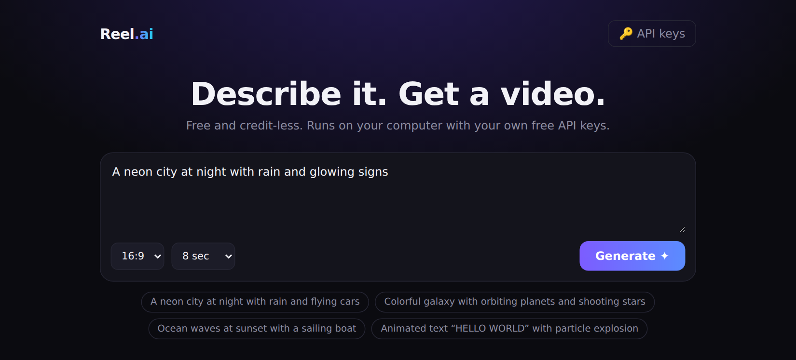

<p align="center">
  
</p>

<h1 align="center">🎬 Reel.ai</h1>

<p align="center">
  <b>Free, credit-less AI video generator that runs on your own computer.</b><br>
  Describe a video, the AI writes the animation, and you download an MP4/WebM.
</p>

<p align="center">
  
  &nbsp;
  
  &nbsp;
  
  &nbsp;
  
</p>

<br>

---

## ✨ Features

- 🆓 **Free and credit-less**: uses the free tiers of Gemini or OpenRouter

- 🔑 **Multiple API keys**: add and remove keys from the web UI

- 🔁 **Automatic fallback**: if a model fails, it switches to the next model, then the next key

- 🎞️ **Background rendering**: you only see the finished video

- ⬇️ **One-click download** as MP4 or WebM

- 📦 **Zero dependencies**: just Node.js

- 🔒 **Private**: keys stay on your machine, and the server listens on `127.0.0.1` only

<br>

---

## 🎥 What can it create?

Reel.ai draws every video with code on an HTML canvas, so it is best at stylized animation.

| Type | Examples |
|:---|:---|
| 🎨 **2D animation** | Cartoon-style scenes, sunsets, oceans, cities, space |
| 🕴️ **Stick-man animation** | Walking, running, jumping and waving stick figures |
| 🧊 **Simple 3D look** | Rotating cubes, spheres, wireframes and tunnels drawn with perspective |
| ✨ **Motion graphics** | Logo intros, titles, animated text and transitions |
| 🌌 **Particles and effects** | Fireworks, stars, rain, snow, explosions |
| 📊 **Animated visuals** | Charts, counters, timelines and infographics |
| 🌀 **Abstract and generative art** | Gradients, waves, patterns and loops |

**Not supported yet:** photorealistic video, real 3D models, human faces and voices, and audio or music.

> 🚧 **This is just the beginning.** We will keep making Reel.ai better, with higher-quality animation, real 3D, sound and more. Stay tuned!

<br>

---

## 🚀 Quick start

```bash
git clone https://github.com/sabin404/reel.ai.git
cd reel.ai
node server.js
```

Open **http://localhost:3000** in Chrome or Edge, then:

1. Click **🔑 API keys** and add a free key

2. Type a prompt and choose the size and length

3. Click **Generate** and download your video

<br>

---

## 🔑 Get a free API key

| Provider | Link | Note |
|:---|:---|:---|
| Google Gemini | [aistudio.google.com/apikey](https://aistudio.google.com/apikey) | Free tier |
| OpenRouter | [openrouter.ai/keys](https://openrouter.ai/keys) | Enable free models in [privacy settings](https://openrouter.ai/settings/privacy) |

<br>

---

## ⚙️ How it works

```
Prompt → AI writes canvas code → rendered in a hidden canvas
       → recorded with MediaRecorder → video ready to download
```

<br>

---

## 🛠 Troubleshooting

| Problem | Fix |
|:---|:---|
| Stuck on "Imagining…" | Check the terminal. It prints ✓ or ✗ for every model tried |
| "All keys/models failed" | Free quota used up, or the key doesn't match the provider. Wait or add another key |
| Black or empty video | Keep the browser tab visible while it renders |
| Can't open the app | Make sure `node server.js` is still running |

<br>

---

## 🗺️ Roadmap

- [x] Multiple API keys with automatic fallback
- [x] Download as MP4 / WebM
- [ ] Better quality and smoother animation
- [ ] Real 3D scenes (Three.js)
- [ ] Characters and stick-man motion library
- [ ] Background music and sound effects
- [ ] Video history and project saving
- [ ] More AI providers

Ideas or requests? Open an [issue](https://github.com/sabin404/reel.ai/issues).

<br>

---

## 📄 License

MIT. See [LICENSE](LICENSE).
